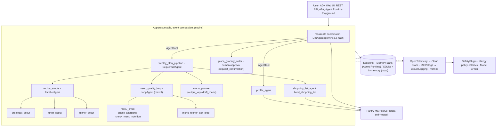

# 🥗 MealMate: Family Meal-Planning & Grocery Concierge Agent

> **Concierge track**, *AI in 5 Days* assessment. A multi-agent system built with the
> [Google Agent Development Kit (ADK)](https://google.github.io/adk-docs/) and
> deployed to **Gemini Enterprise Agent Platform: Agent Runtime**.

[](https://github.com/albertelias-star/L200-AI-In-5Days/actions/workflows/ci.yml)

## The problem

Planning a healthy week of family meals takes hours. You juggle allergies, diets,
picky eaters, what is already in the pantry, cooking time, and a grocery budget,
then turn it into a shopping list and an order. It is repetitive, error-prone, and
an allergy mistake can be dangerous.

## The solution

**MealMate** is a concierge agent that remembers the household (size, allergies,
diets, budget, pantry and past ratings). It then:

1. **Scouts recipes in parallel** for breakfast, lunch and dinner within your constraints.
2. **Drafts a varied 7-day menu** with a stronger planning model.
3. **Reviews the menu in a critic ⇄ refiner loop** that runs deterministic allergen and nutrition checks.
4. **Builds a costed, aisle-grouped shopping list** in Qatari Riyal (QAR), skipping pantry items.
5. **Asks for your explicit approval** before placing the (simulated) grocery order.
6. **Remembers** preferences and feedback across sessions.

All recipe and price data is **synthetic and bundled**, so the project is reproducible
with no third-party API keys. Gemini is the only external dependency.

---

## Architecture



| Agent | Type | Model | Responsibility |
|---|---|---|---|
| `mealmate` | `LlmAgent` (coordinator) | smart | Conversation, routing, presenting results, ordering |
| `profile_agent` | `LlmAgent` via `AgentTool` | fast | Collect and save household profile and pantry |
| `weekly_plan_pipeline` | `SequentialAgent` | n/a | Deterministic plan → review → list pipeline |
| `recipe_scouts` | `ParallelAgent` | fast | 3 scouts run concurrently (`output_key` → state) |
| `menu_planner` | `LlmAgent` | smart | 7-day menu JSON from scouted options |
| `menu_quality_loop` | `LoopAgent` | fast/smart | Critic runs tools; refiner fixes or calls `exit_loop` |
| `shopping_list_agent` | `LlmAgent` | fast | Pantry-aware, costed shopping list |

**Why multi-agent?** The course warns against using multiple agents by default, so every split here is justified:
- the three scouts are independent and genuinely run in **parallel**;
- the critic/refiner pair is an **adversarial check-and-balance**;
- **model routing** sends high-volume worker steps to a cheaper model (`gemini-3.5-flash-lite`) and reserves the stronger model (`gemini-3.8-flash`) for planning and conversation.

---

## How it maps to the grading criteria

### 1. Tool & Interface Design
- **Typed, task-shaped function tools** with Google-style docstrings (ADK builds the schema from them). Tools return `{"status": ...}` with **actionable error messages** (for example "Unknown diet(s) ['keto']. Use only [...]") so the model can self-correct ([`app/tools/`](app/tools)).
- **Tool taxonomy:**
  - retrieval: `search_recipes`, `get_recipe`
  - verification: `check_allergens`, `check_menu_nutrition`
  - action: `build_shopping_list`, `place_grocery_order`
  - state: `save_household_profile`, `rate_recipe`
  - agents-as-tools: `AgentTool`
  - built-in memory tools: `load_memory`, `preload_memory`
- **MCP:** a self-hosted **Pantry MCP server** ([`mcp_servers/pantry/server.py`](mcp_servers/pantry/server.py)) with input validation, atomic writes and MCP tool annotations (`readOnlyHint`, `destructiveHint`, `idempotentHint`). It is consumed through `McpToolset` with a **`tool_filter` allow-list**, and the server process is shared across agents. If MCP is disabled, the agent falls back to in-process tools.
- **Human-in-the-loop tool:** `place_grocery_order` uses `tool_context.request_confirmation()` and the resumable `App` (course Day 2b).
- **Interfaces:**
  - ADK Web UI;
  - FastAPI REST and SSE (`app/fast_api_app.py`);
  - an **A2A** endpoint (`/a2a/app`, Agent Card);
  - the Agent Runtime console Playground;
  - a CLI demo ([`scripts/demo.py`](scripts/demo.py)).

### 2. Context & Memory
- **Short-term:** session events and **state**, with scoped keys: `user:household_profile`, `user:recipe_ratings`, `user:order_history`, `user:pantry` and `temp:metrics`. Sub-agents pass data through `output_key` and `{placeholder}` injection (`{breakfast_options}`, `{draft_menu}`, `{critique}`).
- **Long-term:** `after_agent_callback` → `callback_context.add_session_to_memory()`. Recall uses **`preload_memory`** (pre-fetch) and **`load_memory`** (on demand). On Agent Runtime this is **Memory Bank**; locally it is `InMemoryMemoryService`.
- **Persistence:** `DatabaseSessionService` (SQLite) in the demo; managed **Agent Runtime Sessions** in the cloud.
- **Context engineering:**
  - `EventsCompactionConfig` summarises older turns;
  - instructions inject only the state each agent needs;
  - each sub-agent sees a small, focused toolset;
  - large data such as recipes stays in tools, not in prompts.

### 3. Orchestration & Logic
- **All four course patterns:**
  - LLM coordinator with agents-as-tools;
  - `SequentialAgent`;
  - `ParallelAgent`;
  - `LoopAgent` with `exit_loop` and `max_iterations`.
- **Deterministic guardrails around LLM reasoning** ("write software, not rules"):
  - an `enforce_allergy_policy` `before_tool_callback` **blocks** any shopping list containing a household allergen, whatever the prompt says;
  - the order tool enforces a hard QAR cap and flags orders over budget.
- **Resilience:**
  - `HttpRetryOptions` with exponential backoff on 429/5xx;
  - tool exceptions are converted into recoverable errors (`on_tool_error_callback`);
  - loop limits prevent runaway spend ("Denial of Wallet").

### 4. Observability & Tracing
- **Traces:** ADK's OpenTelemetry spans are exported to **Cloud Trace** on Agent Runtime, with the GenAI semantic conventions (`OTEL_SEMCONV_STABILITY_OPT_IN=gen_ai_latest_experimental`). Locally, the `adk web` Trace tab shows the same spans.
- **Logs:** `ObservabilityPlugin` emits **structured JSON** lines for every invocation, LLM call and tool call: the intent before each action and the outcome after it. Cloud Logging parses them automatically.
- **Metrics:** per-invocation LLM calls, tool calls, tool errors, prompt and completion tokens, and latency, also mirrored in `temp:metrics` state.
- **Evaluation:**
  - an ADK **evalset** ([`tests/eval/adk/`](tests/eval/adk)) with **tool-trajectory** (IN_ORDER) and **rubric-based LLM-as-judge** criteria (relevance, food safety, no leakage);
  - an `agents-cli eval` dataset ([`tests/eval/datasets/`](tests/eval/datasets));
  - a load test ([`tests/load_test/`](tests/load_test)).

### 5. Infrastructure & CI/CD
- **Scaffolded with the course's `agents-cli`** (`agents-cli-manifest.yaml`, `deployment_target: agent_runtime`).
- **Terraform** for single-project and CI/CD setups ([`deployment/terraform/`](deployment/terraform)): service accounts, IAM, APIs, buckets, telemetry and **Workload Identity Federation**. No service-account keys anywhere.
- **GitHub Actions:**
  - [`ci.yml`](.github/workflows/ci.yml) runs on every push and needs no credentials: ruff lint and format, codespell, unit tests, **Bandit (SAST)**, **pip-audit (SCA)**, **gitleaks (secrets)** and an MCP smoke test;
  - [`pr_checks.yaml`](.github/workflows/pr_checks.yaml) runs integration tests plus an **evaluation gate** (`adk eval` thresholds);
  - [`staging.yaml`](.github/workflows/staging.yaml) deploys to staging and runs a load test;
  - [`deploy-to-prod.yaml`](.github/workflows/deploy-to-prod.yaml) promotes to production behind manual approval.
- **Security:**
  - least-privilege runtime identity (Agent Identity or a dedicated SA);
  - **Model Armor** floor settings;
  - `SafetyPlugin` (prompt-injection screen and PII redaction);
  - a hardened system prompt;
  - pinned `uv.lock`.

---

## Quickstart

**Prerequisites:** Python 3.11–3.13, [`uv`](https://docs.astral.sh/uv/), and the `gcloud` CLI with a Google Cloud project that has the Vertex AI / Agent Platform API enabled.

```bash
git clone https://github.com/albertelias-star/L200-AI-In-5Days.git
cd L200-AI-In-5Days
uv sync --all-extras

gcloud auth application-default login
cp .env.example .env        # set GOOGLE_CLOUD_PROJECT (or GEMINI_API_KEY for AI Studio)
```

| Try it | Command |
|---|---|
| Web UI (chat, Trace and Eval tabs) | `uv run adk web --session_service_uri sqlite:///.adk/sessions.db` |
| End-to-end demo (profile → plan → approve order → recall) | `uv run python scripts/demo.py` (`--approve` to auto-approve) |
| Unit tests (offline) | `uv run pytest tests/unit` |
| Integration tests (Gemini) | `uv run pytest tests/integration` |
| ADK evaluation | `uv run adk eval app tests/eval/adk/mealmate_core.evalset.json --config_file_path tests/eval/adk/eval_config.json --print_detailed_results` |
| MCP server smoke test | `uv run python scripts/mcp_smoke_test.py` |
| Local API server with A2A | `uv run uvicorn app.fast_api_app:app --port 8000` |

### Example conversation

```text
You:      We're a family of 4, halal, my son is allergic to peanuts and we avoid
          shellfish. Budget 700 QAR, max 45 minutes. We have olive oil, rice and cumin.
MealMate: Saved your profile ... would you like a weekly plan?
You:      Yes please.
MealMate: [7-day table] + [shopping list by aisle, total ≈ 7xx QAR, budget check]
You:      Order it for evening delivery.
MealMate: ⏸ Approve grocery order of 45 items for 739.33 QAR, delivery: evening?
          WARNING: this is over the weekly budget of 700 QAR.   → [Approve]
MealMate: ✅ Order MM-61082FF2 placed (simulated).
```

## Deploy to Agent Runtime

```bash
agents-cli deploy --project <PROJECT_ID> --region us-central1 \
  --update-env-vars="GOOGLE_CLOUD_AGENT_ENGINE_ENABLE_TELEMETRY=true,OTEL_SEMCONV_STABILITY_OPT_IN=gen_ai_latest_experimental,OTEL_INSTRUMENTATION_GENAI_CAPTURE_MESSAGE_CONTENT=EVENT_ONLY,MEALMATE_ENABLE_MCP=false"
```

The deployed agent runs with its own **Agent Identity**, managed **Sessions**, **Memory Bank** and **Cloud Trace**. Turn on **Model Armor floor settings** (prompt injection and jailbreak: *Block High*; RAI filters: *High*) in the console. CI/CD setup: `agents-cli infra cicd` (see [`deployment/`](deployment)).

## Configuration

All settings are environment variables ([`app/config.py`](app/config.py)):

| Variable | Default | Purpose |
|---|---|---|
| `MEALMATE_FAST_MODEL` | `gemini-3.5-flash-lite` | Worker agents (scouts, critic, shopper, profile) |
| `MEALMATE_SMART_MODEL` | `gemini-3.8-flash` | Coordinator, planner, refiner |
| `MEALMATE_MAX_ORDER_QAR` | `1500` | Hard cap enforced in code |
| `MEALMATE_MAX_LOOP_ITERATIONS` | `3` | Critic/refiner loop limit |
| `MEALMATE_ENABLE_MCP` | `true` | Use the Pantry MCP server (else in-process fallback) |
| `MEALMATE_COMPACTION_INTERVAL` | `6` | Turns between context compactions |

## Project structure

```text
app/
  agent.py              # agents, orchestration, App (plugins, compaction, resumability)
  prompts.py            # versioned instructions for every agent
  callbacks.py          # allergy policy (before_tool) + memory (after_agent)
  plugins/              # SafetyPlugin, ObservabilityPlugin
  tools/                # recipes, nutrition, shopping, profile, order (HITL), pantry (MCP)
  data/                 # synthetic recipes + QAR prices
  fast_api_app.py       # REST + A2A + ADK web server (agents-cli scaffold)
mcp_servers/pantry/     # self-hosted MCP server
scripts/                # demo.py, mcp_smoke_test.py
tests/unit|integration|eval|load_test
deployment/terraform/   # IaC for single-project and CI/CD (WIF)
specs/                  # Gherkin behaviour specs (spec-driven development)
.github/workflows/      # CI, PR eval gate, staging, prod
```

## Limitations & next steps

- Recipes and prices are synthetic. A real deployment would put a grocery partner's catalog API behind the MCP server.
- Ordering is simulated. Payments would follow the AP2 mandate pattern covered in the course.
- `SequentialAgent`, `ParallelAgent` and `LoopAgent` are deprecated in ADK 2.x in favour of `Workflow`. They are kept here because `Workflow` cannot yet be used as an `AgentTool`/sub-agent of an `LlmAgent`, which this design needs.

---

*Built for the Google "AI in 5 Days" course assessment. Licensed under Apache 2.0.*
